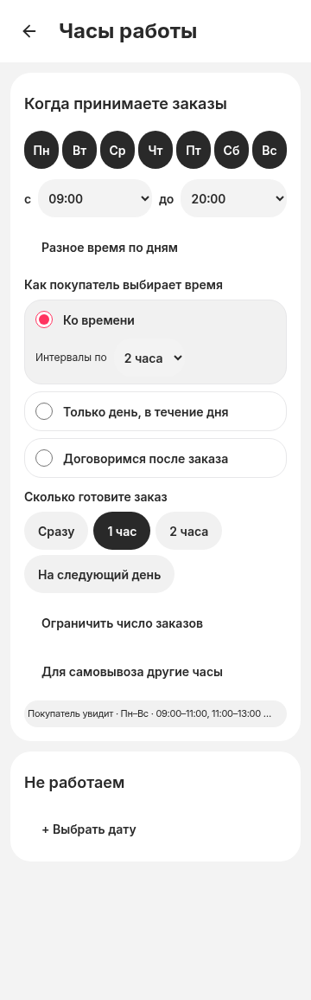
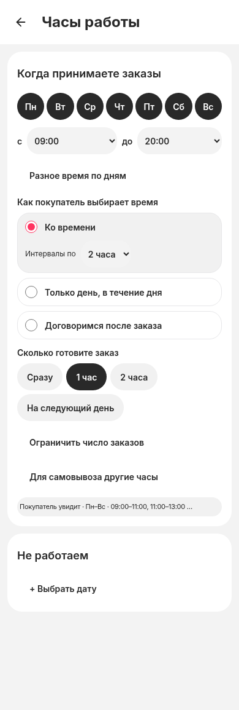
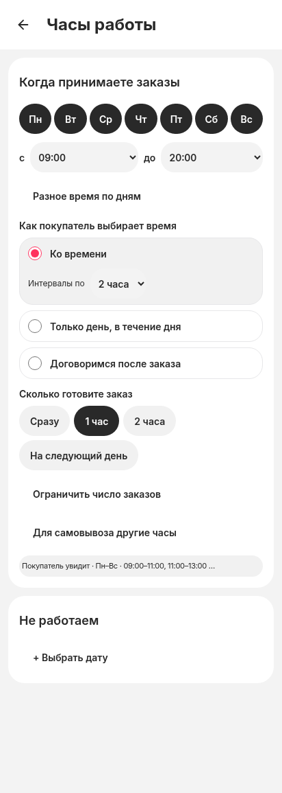

# Блок 7 · «Часы работы» по §14

Спецификация принята в [PR #158](https://github.com/vir2ozz2009/korzina/pull/158). Снимки общего расписания сделаны в Chromium с тестовыми данными.

| 360 px | 390 px | 412 px |
| --- | --- | --- |
|  |  |  |

## Проверки

| Пункт | Что проверяет тест |
| --- | --- |
| §14.1 | При общем расписании сервер строит одинаковые окна для доставки и самовывоза. В кабинете отдельный блок открывается по кнопке и возвращается к общим часам. |
| §14.2 | Семь кнопок включают рабочие дни. Можно задать общее время и время каждого выбранного дня. Сервер отклоняет два диапазона на день в новом формате. |
| §14.3 | Три режима, три длительности, автоматическая нарезка до закрытия. Одно старое окно 09:00–20:00 отображается ближайшим вариантом в три часа. До нажатия «Сохранить» запрос на запись отсутствует. |
| §14.4 | Четыре срока подготовки видны в кабинете. Сервер проверяет готовность без прежней отсечки. «На следующий день» закрывает сегодня и оставляет открытие следующего рабочего дня. |
| §14.5 | В календаре прошедшую дату выбрать нельзя. Чип сохраняется общей кнопкой и удаляется. Покупателю закрытая дата недоступна. |
| §14.6 | По умолчанию лимита нет. Браузер проверяет установку и снятие, сервер проверяет отказ для полного окна. |
| §14.7 | Строка «Покупатель увидит» меняется сразу при выборе дней и длительности интервала. |
| §14.8 | На всех трёх ширинах контролы внутри карточки, первые два интервала помещаются в строку и заголовок при прокрутке остаётся ниже шапки. |

Браузерные шаги находятся в [e2e/shop-hours.ts](../../e2e/shop-hours.ts) и идут внутри сценария блока 7. Правила сохранения и доступности проверяет [hours-section14.test.ts](../../server/modules/fulfillment/hours-section14.test.ts).

В списках времени выбран шаг 15 минут. Точное значение из существующего расписания остаётся доступным, даже если оно между шагами. При явном сохранении по §14 первый старт и последнее закрытие старого дня образуют один диапазон.

## Перепроверка сценария 06 на demo · 21.11.2026

Магазин `test2`, сборка `e4c3e02`. Продавец сохранял настройки в Chrome, покупатель проверял получение в отдельной браузерной сессии. [Кабинет](https://demo.korzina.app/seller/hours?shop=test2&store=test2) · [Витрина](https://demo.korzina.app/?shop=test2).

| Пункт | Что подтвердилось |
| --- | --- |
| §14.1–2 | Общее расписание сохранилось для обоих способов. При раздельных часах доставка в понедельник осталась 09:00–20:00, самовывоз стал 11:00–19:00. Во вторник самовывоз остался 09:00–20:00. Выключенное воскресенье покупатель выбрать не мог. |
| §14.3 | В оформлении видны сохранённые интервалы по 1, 2 и 3 часа. Двухчасовые интервалы заканчиваются укороченным окном 19:00–20:00. В режиме «Только день» можно выбрать дату, в режиме «Договоримся после заказа» выбор времени скрыт. В браузерном тесте с прежним расписанием исходный интервал 09:00–20:00 подставляет ближайшие 3 часа, запрос записи появляется после сохранения. |
| §14.4 | В API сохранились все четыре варианта подготовки. При «На следующий день» покупатель не мог выбрать 21 ноября, 22 ноября выбор открывался с 09:00. Прошедшие интервалы подтверждены отдельно по API. |
| §14.5 | Календарь блокировал прошедшую дату. Выходной 24 ноября сохранился после перезагрузки и был недоступен покупателю. В списке дат он подписан «Занято». Удаление выходного сохранилось. |
| §14.6 | На demo сохранился лимит 1 заказ на интервал, затем ограничение снялось. Отказ для полного окна проверен в изолированном серверном тесте. На demo проверенные будущие интервалы при лимите 1 оставались свободными. |
| §14.7–8 | Строка «Покупатель увидит» менялась до сохранения, API до нажатия «Сохранить» возвращал предыдущую ревизию. Вёрстка и прокрутка прошли браузерный тест на сборке demo при 360, 390 и 412 px с тестовыми ответами API. |

Заказ №63 сохранил прежнее окно 09:00–20:00 на 23 ноября. Настройки и рассчитанное расписание восстановлены и совпали с исходными по API. Временная корзина очищена. Прошли один браузерный сценарий и семь целевых серверных тестов.

В начатой корзине после смены режима с интервалов на «Только день» строка получения сохраняла ранее выбранный интервал. Окно выбора уже предлагало только дату, и при её подтверждении часы исчезли из строки получения.

## Исправления после перепроверки

| Пункт | Регрессия |
| --- | --- |
| §14.5 · Выходной и лимит | [Тест расписания](../../server/modules/fulfillment/hours-section14.test.ts) различает нерабочую дату и исчерпанный лимит в обоих режимах. [Сценарий покупателя](../../e2e/receiving-recheck.ts) проверяет подписи «Не работаем» и «Занято» в списке дат. |
| §14.3 · Смена режима в начатой корзине | [Сценарий покупателя](../../e2e/receiving-recheck.ts) меняет ответ расписания после выбора интервала, проверяет подсказку и сброс сохранённого времени, затем даёт выбрать действующее время. [Тест оформления](../../server/modules/checkout/checkout.test.ts) меняет расписание после расчёта, проверяет отказ без создания заказа и повторное оформление в обоих новых режимах. |
| §14.7–8 · Экран часов | У действий добавлен значок ›. Заголовок «Покупатель увидит» крупнее, расписание вынесено под него. [Chromium](../../e2e/shop-hours.ts) проверяет предпросмотр на 360, 390 и 412 px. |
