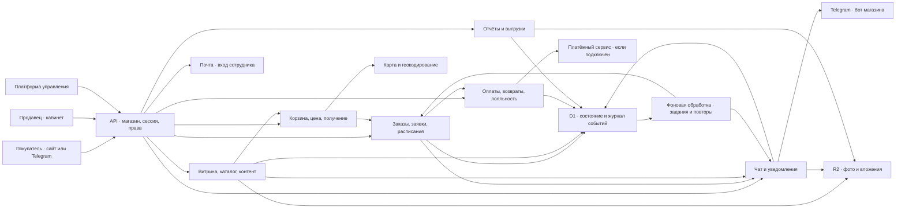
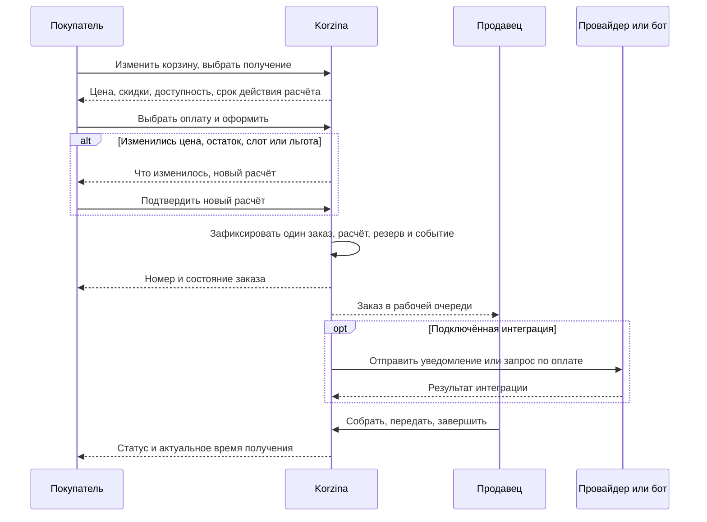
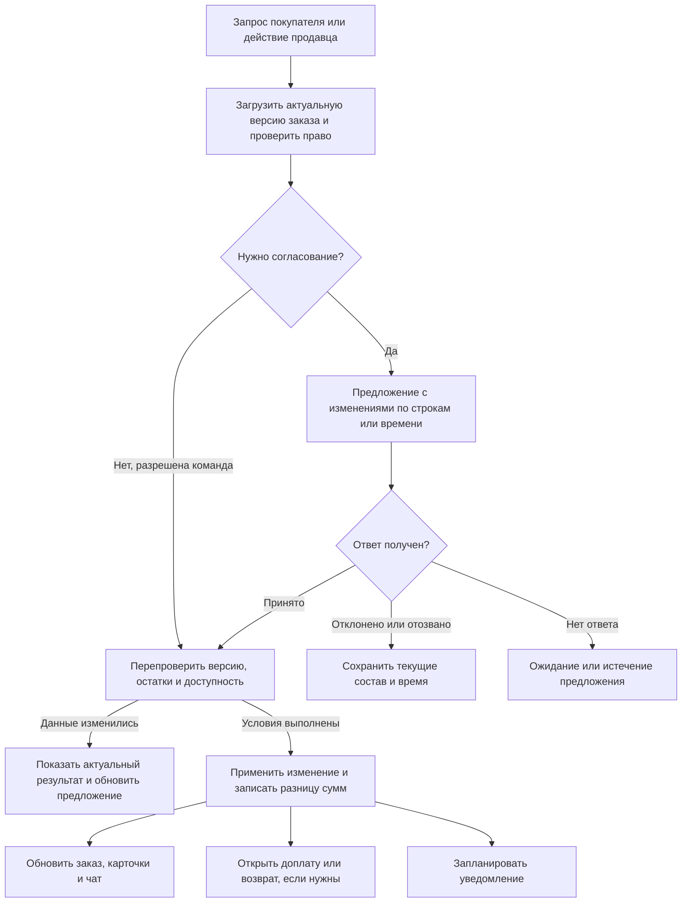
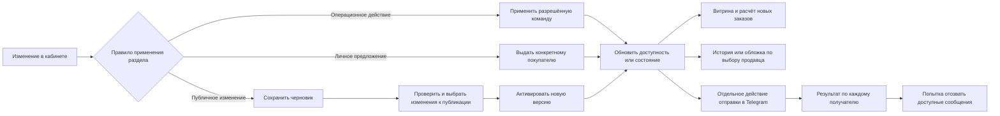

# Korzina · карта процессов

Карта связывает действия покупателя и продавца с серверными модулями и внешними системами. Правила переходов, модель данных и условия приёмки описаны в [системном анализе](<Korzina — системный анализ.md>). Ссылки на исходные и финальные кадры собраны в [карте блоков](<Карта исходных блоков Korzina.tsv>). Объём включает блоки 30–95 и ненумерованные разделы продавца.

## 1. Карта систем

Покупатель и продавец работают с одним заказом через разные представления. Чат, карточка, календарь и Telegram получают собственное представление из общего состояния. Внешние системы возвращают факты о своих операциях. Право выполнить команду и изменение данных проверяет сервер Korzina.

## 2. Оформление и получение

Ручной перевод с QR использует отдельный путь подготовки с сохранением файла. Покупатель один раз подтверждает действие «Прикрепить и оформить». Повтор проверяет результат той же операции. При внешней оплате порядок создания попытки и фиксации заказа задаёт подтверждённый контракт конкретного метода. Цена доставки, которую предстоит узнать, не входит в сумму к оплате за товары.

## 3. Изменение действующего заказа

Сюда входят замена, уменьшение количества, удаление строки, перенос получения и добавление товаров из новой корзины. Время меняется вместе с резервом слота. Для удаления последней строки используется явная отмена. Доплата за изменение не задерживает сборку и передачу. Чат может принять действие на карточке предложения через тот же серверный переход, что и экран заказа.

## 4. От настройки продавца до витрины и Telegram

Публикация витрины и отправка рассылки дают отдельные результаты. Для промокода, акции или набора продавец может создать историю, обложку или сообщение из исходного предложения с заполненным шаблоном. Каждое размещение сохраняет собственный срок и цель перехода. Отключение предложения снимает дальнейшую применимость. Отзыв сообщения обрабатывается по адресатам.

## 5. Реестр процессов

| Процесс и исходники | Кто начинает → что получает другая сторона | Кто ведёт данные и ключевые развилки |
| --- | --- | --- |
| **P01. Доступ, магазин и первый запуск** · 38, 44, 50, 69–72, 86 | Покупатель входит через бота или оставляет номер в предусмотренном сценарии. Владелец настраивает магазин, сотрудника и его доступ. | Сессии и права. Телефон без подтверждения, восстановление, отзыв доступа, привязка и смена бота, состояние первого запуска. |
| **P02. Витрина, каталог и контент** · 45–48, 56–58 покупателя, 62–63, 87–92 | Продавец настраивает товары, фасовки, разделы, главную, истории и обложки. Покупатель видит активную версию и открывает доступную цель. | Каталог, остатки, публикация и медиахранилище. Скрытые фасовки, пустые разделы, 1–5 товаров, расписание контента, поиск. |
| **P03. Корзина, доставка и расчёт** · 30–38, 59 покупателя, 60, 74–77, 82, 93 | Покупатель выбирает состав, адрес, получение и льготы. Продавец задаёт тарифы, зону, интервалы, способы получения и условия акции. | Корзина, расчёт, расписание. Изменение условий, последний остаток, неизвестная доставка, самовывоз, лимит акции. |
| **P04. Оплата, сборка и передача** · 39–40, 58 продавца, 61, 66, 68–69 | Покупатель оформляет заказ. Продавец проверяет оплату и ведёт сборку, доставку или выдачу. | Заказы, оплаты, календарь. Перевод и QR, оплата при получении, частичная оплата, ручная проверка и отображение статуса заказа в боте. [Виджеты заказов в Telegram](https://www.figma.com/design/AKQ8vaPw3z1qqiVfGv7H2d/?node-id=25-2). |
| **P05. Изменение, отмена и повтор** · 40–43, 54, 58–59 продавца, 66, 68 | Любая сторона инициирует разрешённое изменение. Другая получает предложение или уведомление. | Заказы и согласования, остатки, расписание и расчёты. Замена, собственный выбор, перенос, доплата, отмена, возврат и повтор заказа. |
| **P06. Профиль, чат, отзывы и поддержка** · 43–44, 49–50, 65, 67, 72 | Покупатель пишет по заказу, управляет избранным и оценивает купленные товары. Продавец отвечает и управляет публичной видимостью. | Профиль, история заказов, чат, вложения, отзывы, отдельный канал поддержки. |
| **P07. Акции, личные предложения и приглашения** · 33–34, 45, 52, 56, 59 покупателя, 73–83, 87, 93 | Продавец публикует общую акцию или выдаёт личную. Покупатель получает право на скидку, кэшбэк или награду по приглашению. | Продвижение, профиль, расчёт и денежный журнал. Условия, сроки, отключение, лимиты, квалифицирующий заказ, учёт выдачи и применения. |
| **P08. Регулярный заказ** · 53, 77 | Покупатель задаёт расписание, получает напоминание или подготовленную корзину и подтверждает её. Продавец включает функцию и при желании задаёт скидку. | Расписания и расчёт. Повтор задания, изменение цены, пропуск, пауза, последующие покупки. |
| **P09. Изготовление на заказ** · 51, 84–85 | Покупатель отправляет пожелания и фото. Продавец предлагает дату, стоимость и условия оплаты. | Заявка и предложение, после принятия один связанный заказ. Редакция условий, предоплата, остаток суммы. |
| **P10. Telegram, размещение и отзыв** · 55, 58 покупателя, 70, 79–80, 89–91, 94–95 | Продавец выбирает контент, аудиторию и действие. Покупатель получает сообщение бота или видит контент на витрине. | Контент, аудитория, задания и результаты отправки. Предпросмотр, срок, частичная отправка и частичный отзыв. |
| **P11. Рабочий день, деньги, данные и статистика** · 58–59 продавца, 62 вложенный, 66–68, 72, 84 | Кабинет группирует заказы и заявки по дню, а финансовые действия по фактическим операциям. Продавец фильтрует, выгружает и открывает исходный объект. | Заказы и события, денежный журнал, права, агрегаты. Календарь при пустой дате, часовой пояс, заказ без оплаты, расчёт напрямую с курьером. |

Блок 55 реализуется через истории и Telegram, блок 64 заменён актуальным продвижением 73–83. Ненумерованные уточнения архитектуры и карточки заказа входят в P01, P04, P05, P10 и P11.
